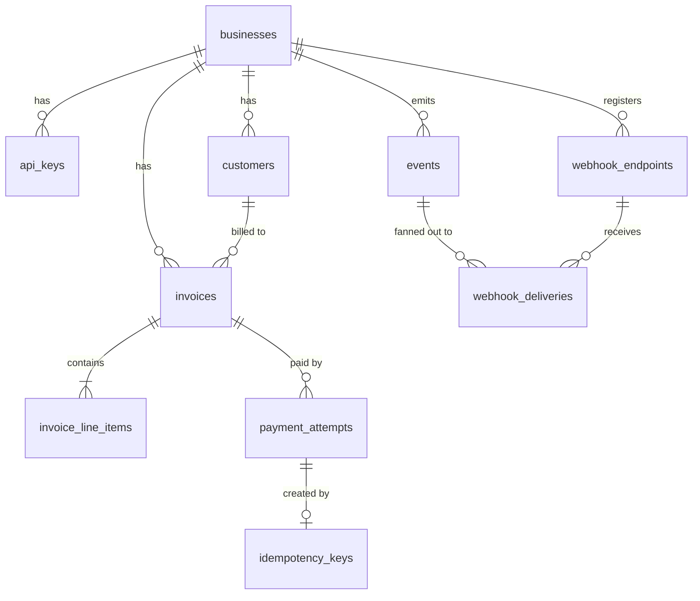
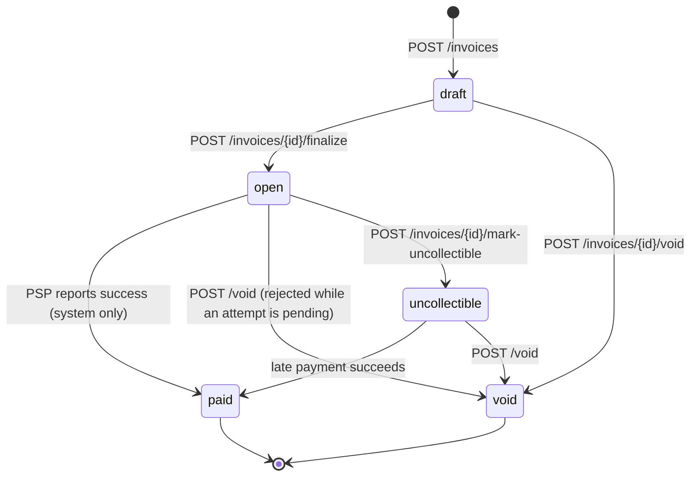

# Design: Invoice & Payment Service

```
 client ──HTTP──▶ api (invoice-service) ──HTTP, 5s timeout──▶ mock-psp
                    │  background workers (same process):
                    │   ├─ reconciler: resolves `pending` attempts via PSP status lookup
                    │   └─ webhook sender: delivers the outbox, signs, retries
                    ▼
                 Postgres 18 ──outbox rows──▶ webhook sender ──signed POST──▶ business endpoint
```

The idea that holds the design together: **never hold a database transaction or lock while waiting
on the network, and never guess about money.** Every state change is a short transaction; the PSP
call and webhook sends happen between transactions; and any PSP answer that isn't explicit is
treated as *unknown*, not as failure.

Money is `i64` cents end to end (`BIGINT` in SQL); decimals are rejected at parse time and totals use
checked arithmetic.

---

## 1. Data Model



| Table | Key columns | Indexes and constraints |
|---|---|---|
| `api_keys` | business_id, key_prefix, key_hash, revoked_at | `UNIQUE (key_hash)` |
| `customers` | business_id, name, email | `(business_id, id DESC)` |
| `invoices` | business_id, customer_id, state, total_cents, due_date | `(business_id, state, id DESC)`; `CHECK` on state and `total_cents > 0`; FK `(customer_id, business_id)` |
| `invoice_line_items` | invoice_id, quantity, unit_amount_cents, amount_cents | `CHECK amount_cents = quantity * unit_amount_cents`, `quantity > 0` |
| `payment_attempts` | invoice_id, amount_cents, status, failure_code, psp_ref | **unique `(invoice_id) WHERE status='pending'`**; unique `(invoice_id) WHERE status='succeeded'`; `(created_at) WHERE status='pending'` |
| `idempotency_keys` | **PK (business_id, key)**, request_hash, attempt_id | |
| `webhook_endpoints` | business_id, url, secret | |
| `events` | business_id, type, payload (jsonb) | the outbox |
| `webhook_deliveries` | event_id, endpoint_id, status, attempt_count, next_attempt_at | `(next_attempt_at) WHERE status='pending'`; `UNIQUE (event_id, endpoint_id)` |

**Why this shape:**
- **UUID v7 primary keys:** unguessable (serials leak volume) but time-ordered, unlike v4, so inserts
  append to the index and the ID doubles as a pagination cursor. Tenant isolation still comes from
  filtering every query on `business_id`, not from ID secrecy.
- **Line items in their own table, not JSONB,** so the database enforces positive quantities and
  `amount = quantity × unit price`. JSONB can't constrain money.
- **Composite foreign keys `(id, business_id)`** make cross-tenant references impossible in the database.
- **`total_cents` is stored**; it can't drift because line items never change after creation.
- **Events and deliveries are separate** because one event fans out to several endpoints, each
  retrying independently.

**At 100x scale:** partition `idempotency_keys`, `events` and `webhook_deliveries` by `created_at`
and archive old partitions (they grow forever by design); add `(business_id, id)` for unfiltered invoice
lists; serve lists from read replicas; batch the reconciler's PSP lookups.

---

## 2. Invoice State Machine



| From | To | Trigger |
|---|---|---|
| draft | open | `POST /invoices/{id}/finalize` |
| draft | void | `POST /invoices/{id}/void` |
| open | paid | PSP success, recorded by `/pay` or the reconciler (never a client) |
| open | void | `POST /invoices/{id}/void`; 409 while an attempt is pending |
| open | uncollectible | `POST /invoices/{id}/mark-uncollectible` |
| uncollectible | paid | a late payment succeeds |
| uncollectible | void | `POST /invoices/{id}/void` |

**Terminal:** `paid`, `void`. **Payable:** `open`, `uncollectible`. **Reversible:** none. Nothing
returns to `draft` or `open`, and `uncollectible` only moves forward.

**Why these states:**
- **`draft` exists** so an invoice can't be paid until the business finalizes it. I didn't
  build draft editing (see §6), but "not payable yet" is reason enough to keep the state.
- **A declined card doesn't change the invoice.** A decline is a fact about one *attempt*, not the
  invoice. The invoice stays `open` so the customer can try another card. A `payment_failed` invoice
  state would need an extra transition back to `open` just to allow a retry.
- **An in-flight payment lives on the attempt (`pending`), not the invoice.** This was the part I
  deliberated over. It allows a second `/pay` to start while the first is still at the PSP, which is
  a possible double charge. I kept the model and closed the hole in the database: a unique index
  allows only one pending attempt per invoice (§3a).
- **`uncollectible` can still become `paid`:** refusing money that arrives late is worse than taking it.
- **`paid` is terminal;** a refund would be its own record, not a step backwards.
- **"Overdue" is derived** (`open` and `due_date < today`), so no timer job is needed.

**How invalid transitions are rejected:** `InvoiceState::can_transition_to` (`domain/invoice_state.rs`)
is the only list of allowed pairs, and a unit test asserts exactly those 7. Every state change locks
the invoice row, checks that function, and writes with `AND state = $from` as a second guard.
Invalid moves get `409 invalid_state_transition`.

---

## 3. Payment Correctness & Failure Modes

```
TX1  lock invoice (FOR UPDATE) → idempotency lookup → payable? →
     INSERT attempt 'pending' + INSERT idempotency key → COMMIT
PSP  POST /charges, Idempotency-Key = attempt_id, 5s timeout. No transaction or lock is open.
TX2  lock invoice → UPDATE attempt … WHERE status = 'pending' → invoice → paid → outbox event → COMMIT
```

| PSP answer | Attempt | Invoice | Response |
|---|---|---|---|
| succeeded | succeeded | paid | `200` |
| declined / insufficient funds | failed | stays open | `402` (error envelope + attempt) |
| timeout, 5xx, dropped connection | **pending** | unchanged | **`202`** |

**Concurrency mechanism:** a **row-level lock** (`SELECT … FOR UPDATE`) on the invoice plus a
**partial unique index** allowing one pending attempt per invoice. Every path locks the invoice first,
and no transaction locks two invoices, so lock cycles can't form. *Optimistic concurrency* would
still need the one-in-flight-charge rule, plus retry loops; an *advisory lock* only works if every
path remembers it; *SERIALIZABLE* adds retries everywhere and can't span the PSP call, which sits
between two transactions by design.

**(a) Two `/pay` at the same instant.** A takes the lock, inserts its pending attempt, commits,
and **releases the lock before calling the PSP**. B then gets the lock and sees the invoice still
`open`, so the state check passes. What stops B is the unique index: its insert fails, and it gets
`409 payment_in_progress`. If B arrives after A has finished, it gets `409 invoice_not_payable`. If B
uses the same Idempotency-Key, it gets a replay of A's attempt instead. A test fires 20
concurrent requests: one succeeds, one PSP call. With the index removed, the PSP charged twice and the
"one succeeded per invoice" index only stopped the second success being *recorded*: **the pending
index prevents double charges; the success index only detects them.**

**(b) `tok_timeout`.** We give up after 5s (about 50× normal latency, and cheap because no DB
connection is held) and return `202` with the attempt `pending`; the invoice is untouched. Not 504,
because the card may have been charged. While pending, `/pay` and void get 409, so the invoice is
blocked for 30–40s. I accept that as the price of never charging twice. The reconciler (every 10s,
attempts pending over 30s) calls `GET /charges/{attempt_id}`, records the result, and the invoice becomes
`paid` with an `invoice.paid` webhook. The caller learns the outcome by polling `GET /payment_attempts/{id}`,
from the webhook, or by retrying the same key. The service refuses to start unless
`RECONCILE_AFTER_MS ≥ 3 × PSP_TIMEOUT_MS`; otherwise a lookup during an in-flight request could see
`not_found`, mark the attempt failed, and the late charge would then succeed.

**(c) The PSP succeeded, but we crashed before TX2.** TX1 already committed the pending attempt and
its key. A retry with the same key returns that attempt (`202`) without calling the PSP; a new key gets
409. The reconciler looks the charge up by `attempt_id`, finds it succeeded, and marks the invoice
`paid`. If the PSP never got the request, the lookup says `not_found` and the attempt is marked failed
(safe, because the PSP records a charge before processing it). `attempt_id` is also the PSP's
idempotency key, so not even a resend can charge twice. A test reproduces this and asserts one PSP call.

**(d) The same key with a different body.** `422 idempotency_key_reused`, with no PSP call. The
stored hash covers the path and the parsed body, so reusing a key on another invoice is also a
mismatch. I first wanted 409, then followed the IETF Idempotency-Key draft, which specifies 422.
**Keys never expire:** with a 24h window (Stripe's), a retry at hour 25 could charge again, which is
exactly what the key exists to prevent. The rows are tiny, and there's no cleanup job.

**(e) `/pay` on a `paid` invoice.** A new key gets `409 invoice_not_payable`. The original key
replays the successful attempt (`200`), because the key lookup runs *before* the payable check.
Otherwise a client retrying a payment that worked would be told it failed.

---

## 4. Webhook Design

- **Events:** `invoice.created`, `invoice.paid`, `invoice.payment_failed`. Body:
  `{"id", "type", "created_at", "data": {"invoice", "payment_attempt"}}`.
- **Signing:** `Dodo-Signature: t=<unix>,v1=<hex HMAC-SHA256(secret, "<t>.<raw body>")>`. Each
  endpoint has its own secret, shown once at registration. The timestamp is *inside* the signed
  string, so a captured webhook can't be replayed with a fresh timestamp. Receivers reject
  `|now − t| > 5 min` and compare in constant time (`webhook-receiver/` is a working example).
  The secret is stored in plaintext because HMAC needs the raw secret to sign, so it can't be hashed
  like an API key.
- **Decoupled through a transactional outbox:** the event and its delivery rows are written **in the
  same transaction as the state change**, so a paid invoice always has its event. A `tokio::spawn`
  after responding would lose it on a crash. A worker claims due rows with a 60s lease (one statement
  with `FOR UPDATE SKIP LOCKED`), then sends with no transaction open.
- **Retries:** 8 attempts, waiting 30s, 2m, 10m, 30m, 1h, 3h, then 6h after each failure. That's a
  total budget of **10h42m30s**. Each attempt has a 10s timeout, and any 2xx counts as delivered.
- **When retries run out:** the delivery is marked `failed`, keeping the last status code and error.
  The invoice table is the source of truth, so a business that missed events re-syncs with
  `GET /invoices?state=…`.
- **Guarantees:** at-least-once delivery, so receivers dedupe on the event `id`. Order is not
  guaranteed (testing showed `payment_failed` arriving before `created`), so receivers should trust
  `data.invoice.state`, not arrival order.

---

## 5. API Key Model

- **Generation:** `sk_` + 32 random bytes (hex). The prefix lets people and secret scanners spot leaks.
- **Storage:** SHA-256 hash (unique index) plus the first 11 characters for identification; the full
  key is printed once. Not bcrypt/argon2: slow hashes protect guessable passwords, and a 256-bit random
  key can't be guessed; bcrypt is also salted, so it can't be looked up by index, and costs ~100ms per request.
- **Transmission:** `Authorization: Bearer sk_…` over TLS.
- **Rotation:** a business can have several active keys. Create a new one, deploy it, then revoke
  the old one.
- **Revocation:** sets `revoked_at`, which is checked on every request, so it takes effect immediately.
- **Key management is CLI-only.** A leaked key can't create more keys for persistence, and it can't
  revoke the owner's keys and lock them out. The cost is that rotation needs an operator, which is
  acceptable at this scope.
- **Blast radius:** full access to one business (customer names and emails, invoices, registering a
  webhook URL to receive future events). Not other businesses, keys, payouts, or card data.

---

## 6. What I Cut and Why

- **Refunds and partial payments** (wanted). A billing system needs them, but they need their own
  record linked to the succeeded payment and `refund.*` events. Out of scope; bolting them on would
  have weakened the core.
- **Webhook redelivery and an events-list endpoint** (wanted). They're the natural answer to missed
  events, but the invoice API already covers reconciliation, and payment correctness came first.
- **Editing draft line items** (wanted). It adds an endpoint, re-pricing and validation without
  touching any hard problem.
- **Webhooks for finalize, void and uncollectible:** one outbox call each, but not required.
- **Self-serve API key endpoints:** left out on purpose (§5).

---

## 7. Production Readiness Gap

1. **Observability.** Safety here depends on pending attempts resolving, so I'd need alerts on
   pending-attempt age and reconciler lag, plus metrics on PSP latency and errors and webhook
   failures, with request IDs in logs. For a Merchant of Record paying out across countries, a stuck
   `pending` is a reconciliation problem that must page someone, not sit in a log.
2. **Rate limiting** per API key, and per IP before auth. Otherwise one merchant, or one leaked key,
   can exhaust the shared DB pool and PSP quota for everyone.
3. **SSRF protection.** Webhook URLs can point at internal addresses or cloud metadata, and we POST
   to them. Block private ranges, and re-check after DNS resolution.

Next after those: webhook secrets encrypted with a KMS, an audit log of state changes, dunning for
open invoices, and multi-currency.
